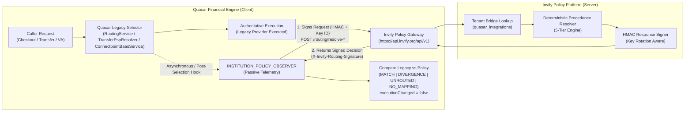

# INVIFY + QUASAR ARCHITECTURE DESIGN SPECIFICATION
## CANONICAL CONTRACT: MULTI-INSTITUTION GOVERNANCE, ONBOARDING, AND PROVIDER ROUTING

**Document Version:** 1.6.0 (Phase 1A.9 Contract Defect Remediation)  
**Specification Date:** October 20, 2026  
**Status:** CANDIDATE FOR INDEPENDENT QUASAR REVALIDATION — PHASE 1B REMAINS FROZEN  
**OpenAPI Specification Version:** 1.6.0 (`docs/architecture/contracts/institution-routing-api.v1.json`)  
**Target Repositories & Environments:**
- **Invify Platform:** `C:\dev\Involve_APP_health` (branch `feature/health-insurance-phase1`)
- **Quasar Financial Engine:** `C:\dev\quasar-institution-routing` (branch `feature/institution-routing-policy`, base commit `3861828f7e4b5c803128d617dfa43acb7e029457`)

---

## 1. EXECUTIVE SUMMARY & APPROVED ARCHITECTURAL BOUNDARIES

### 1.1 Core Decisions
1. **Decision A — Inherit Institution Defaults, Subject to Permitted Tenant Choices:**
   - An institutional code identifies an accredited corporate entity (Bank, HMO, Payment Acquirer).
   - An institutional code is strictly an **identifier**, NOT an authentication credential, API secret, or proof of administrative authority.
   - During onboarding, the tenant inherits the institution's approved default provider for each enabled service, unless the institution's policy explicitly permits tenant overrides (`PERMITTED_FROM_LIST` or `OPEN`).
   - Unauthorized providers are strictly rejected.
2. **Decision B — Multiple Institution Relationships per Tenant:**
   - A single tenant may establish independent, concurrently active relationships with different institutions across distinct services:
     - *Bank A* for Payment Processing (Card acquiring / web checkout).
     - *Bank B* for Dedicated Virtual Accounts (tuition / fee collection).
     - *HMO C* for Health & Wellness Insurance (student/staff health cover).
     - *Acquirer D* for POS terminal switching.
   - Historical and terminated relationships are preserved via partial unique indexing (`WHERE status = 'ACTIVE'`).
3. **Decision C — Strict Service Separation (Institutions vs Business Modes):**
   - **Institution Types:** Regulated corporate partners (`BANK`, `HMO`, `PAYMENT_PROVIDER`, `AGGREGATOR`).
   - **Tenant Business Modes:** Invify operational scopes (`school`, `retail`, `health`, `services`).
   - Schools and retailers are consumers of services, not institution types. Banking defaults must never automatically dictate health insurance, and vice versa.
4. **Decision D — Backward Compatibility & Non-Disruption Guarantee:**
   - 100% additive schema changes.
   - Existing tenants, ledgers, virtual accounts, webhook processors, and payment rails operate without disruption.
   - No fabricated institution codes or fake provider assignments. When a tenant is unmapped or unrouted, Quasar retains its configured legacy provider selection.

---

### 1.2 System Ownership Boundary Matrix

| Domain Responsibility | System Owner | Component Path | Security & Verification Boundary |
|---|---|---|---|
| **Institution Registry (Master)** | **Invify** | `invify-backend/src/modules/institution-registry/` | Authoritative source of legal name, regulatory accreditation, KYC status, and code status. |
| **Tenant Onboarding & Code Entry** | **Invify** | `lib/.../device_onboarding_page.dart` & `src/controllers/onboarding.controller.ts` | Resolves code pre-auth; binds tenant to institution per service. |
| **Provider Routing Policy Engine** | **Invify** | `invify-backend/src/modules/institution-registry/services/tenant-routing-policy-resolver.service.ts` | Evaluates deterministic precedence ladder. Outputs authoritative route + decision trace ID + expiration. |
| **Financial Execution & Dispatch** | **Quasar** | `iips-pay/src/modules/payment/` & `virtual-account/` & `financial-routing/` | Dispatches via executable BaaS/PSP adapters; updates double-entry ledger. |
| **Provider Credentials (Vault)** | **Shared/Segmented** | Invify Integration Vault / Quasar Config Vault | Invify holds tenant business config; Quasar holds merchant/aggregator API keys and bank host secrets. |
| **Health Insurance Subsystem** | **Invify Exclusive** | `invify-backend/src/modules/health-insurance/` | Invify-exclusive domain. Quasar has no HMO adapter or health insurance execution path. |
| **Card-Present Terminal Acquiring** | **POS Host Switch** | `iso8583-switch` (`iso_tcp` / `kimono_https`) | Dedicated ISO8583 POS host switch. Completely separate from CNP checkout routing. |

---

### 1.3 Service-Specific Operational Routing Surfaces & Architectural Diagram

Quasar acts as the HTTP client invoking Invify's Authoritative Policy Engine gateway (`https://api.invify.org/api/v1`). The policy engine evaluates rules and returns a signed policy decision. Quasar's passive `INSTITUTION_POLICY_OBSERVER` records telemetry without altering legacy execution:



1. **Checkout / Card-Not-Present Payments:**
   - **Quasar Execution Path:** `PaymentService.initializePaystackCheckout` -> `RoutingService.evaluateChain` -> `ProviderRoute[]`.
   - **Supported Operations:** `CHECKOUT`, `WEB_PAYMENT`.
   - **Executable Providers in Quasar:** `paystack`, `flutterwave`.
   - **Dedicated Contract Endpoint:** `POST /routing/resolve-checkout-route`.
2. **Bank Transfers & Account Name Enquiry:**
   - **Quasar Execution Path:** `TransferService.processTransfer` / `FinancialRoutingService` -> `TransferPspResolver.resolve` -> `TransferPspRail`.
   - **Supported Operations:** `BANK_TRANSFER`, `NAME_ENQUIRY`.
   - **Executable Providers in Quasar:** `nomba`, `paystack`.
   - **Dedicated Contract Endpoint:** `POST /routing/resolve-transfer-rail`.
3. **Dedicated Virtual Accounts:**
   - **Quasar Execution Path:** `VirtualAccountService.createOrGetStudentVirtualAccount` -> `payments.virtual_account_provider` (`ConnectpointBaasService` or `PaystackService.createDedicatedVirtualAccount`).
   - **Supported Operations:** `VIRTUAL_ACCOUNT_CREATION`.
   - **Executable Providers in Quasar:** `connectpoint`, `paystack`.
   - **Dedicated Contract Endpoint:** `POST /routing/resolve-virtual-account-provider`.
4. **Card-Present Terminal Acquiring (POS):**
   - Managed via Quasar's `iso8583-switch` (`iso_tcp` / `kimono_https`). Not interchangeable with web checkout.
5. **Health Insurance:**
   - Invify-owned (`HEALTH_INSURANCE`). Managed via `health-platform.service.ts`. Quasar has no HMO adapter; health insurance is never routed to Quasar.

---

## 2. PROVIDER CAPABILITY & EXECUTABILITY MATRIX

| Provider Identifier | Operational Service Surface | Quasar Implementation Component | Executability Status in Quasar | Invify Execution Status | Canonical Contract Status (v1.4.0) |
|---|---|---|---|---|---|
| `paystack` | Checkout (CNP) | `PaystackFinancialProviderAdapter` | **IMPLEMENTED & EXECUTABLE** | Supported | Approved Primary / Secondary |
| `flutterwave` | Checkout (CNP) | `FlutterwaveFinancialProviderAdapter` | **IMPLEMENTED & EXECUTABLE** | Supported | Approved Failover / Override |
| `nomba` | Transfers / Payouts | `NombaFinancialProviderAdapter` | **IMPLEMENTED & EXECUTABLE** | Supported | Approved Primary Transfer Rail |
| `paystack` | Transfers / Payouts | `PaystackFinancialProviderAdapter` | **IMPLEMENTED & EXECUTABLE** | Supported | Approved Secondary Transfer Rail |
| `connectpoint` | Dedicated Virtual Accounts | `ConnectpointBaasService` | **IMPLEMENTED & EXECUTABLE** | Supported | Approved Primary VA Provider (Wema BaaS) |
| `paystack` | Dedicated Virtual Accounts | `PaystackService.createDedicatedVirtualAccount` | **IMPLEMENTED & EXECUTABLE** | Supported | Approved Secondary VA Provider |
| `providus` | Virtual Accounts / Transfers | `ProvidusFinancialProviderAdapter` | **UNIMPLEMENTED STUB** | Direct API Executable | Throws exception in Quasar; non-executable |
| `opay` | Any Financial | `OpayFinancialProviderAdapter` | **UNIMPLEMENTED STUB** | Not Integrated | Throws exception in Quasar; non-executable |
| `wema` | Any Financial | Non-existent Enum | **VOCABULARY ERROR** | Non-executable | Replaced with `connectpoint` |
| `hygeia` / `reliance` | Health Insurance | Non-existent Enum | **INVIFY EXCLUSIVE DOMAIN** | Active (`health-platform`) | Exclusively Invify; no Quasar HMO route |
| `kimono` / `iso_tcp` | Card-Present Acquiring | `iso8583-switch` | **POS SWITCH DOMAIN** | POS Terminal Host | Handled by POS host switch |

---

## 3. DECISION SEMANTICS & NO-PROVIDER GUARANTEE

The canonical contract defines four explicit outcomes in the 200 OK `RoutingDecision` enum, with system outages represented strictly as HTTP 503 `ErrorResponse`:

```
[ Incoming Operation: (quasarTenantId, serviceType, operationType) ]
                                    |
                                    v
       +------------------------------------------------------------+
       | Step 0: Validate Caller & Mutual HMAC Signature            |
       +------------------------------------------------------------+
         - Verify X-Invify-Routing-Signature, timestamp, nonce, keyId.
         - Assert quasarTenantId is valid UUID v4.
         - Reject bearer token bypass on inter-system policy routes.
                                    |
                                    v
       +------------------------------------------------------------+
       | Step 1: Resolve Tenant Mapping in quasar_integrations       |
       +------------------------------------------------------------+
         - Query: SELECT invify_tenant_id, status FROM quasar_integrations ...
         - If NOT FOUND:
           -> RETURN 200: decision: 'NO_MAPPING', reason: 'TENANT_NOT_MAPPED_IN_INVIFY',
                          provider: null, allowedProviders: [], tier: 'NONE'.
         - If status == 'provisioned':
           -> RETURN 200: decision: 'NO_MAPPING', reason: 'TENANT_INTEGRATION_PROVISIONING',
                          provider: null, allowedProviders: [], tier: 'NONE'.
         - If status == 'suspended':
           -> RETURN 200: decision: 'NO_ELIGIBLE_PROVIDER', reason: 'TENANT_INTEGRATION_SUSPENDED',
                          provider: null, allowedProviders: [], tier: 'NONE'.
         - If status == 'error':
           -> RETURN 200: decision: 'NO_ELIGIBLE_PROVIDER', reason: 'TENANT_INTEGRATION_ERROR',
                          provider: null, allowedProviders: [], tier: 'NONE'.
         - If status == 'active': Proceed to Step 2.
                                    |
                                    v
       +------------------------------------------------------------+
       | Step 2: Resolve Tenant Institution Relationship            |
       +------------------------------------------------------------+
         - If NO RELATIONSHIP ROW:
           -> RETURN 200: decision: 'NO_RELATIONSHIP', provider: null,
                          allowedProviders: [], tier: 'NONE'.
         - If SUSPENDED or TERMINATED:
           -> RETURN 200: decision: 'NO_ELIGIBLE_PROVIDER', provider: null,
                          allowedProviders: [], tier: 'NONE'.
         - If INSTITUTION INACTIVE or KYC UNVERIFIED:
           -> RETURN 200: decision: 'NO_ELIGIBLE_PROVIDER', provider: null,
                          allowedProviders: [], tier: 'NONE'.
                                    |
                                    v
       +------------------------------------------------------------+
       | Step 3: Evaluate Precedence (LOCKED vs OVERRIDE vs DEFAULT)|
       +------------------------------------------------------------+
         - Mandate Institution Default if policy == LOCKED.
         - Apply Tenant Override if active and permitted in list.
         - Otherwise apply Institution Default.
         - Validate candidate is in surface executable enum (paystack|flutterwave, etc.).
                                    |
                                    v
       +------------------------------------------------------------+
       | Step 4: Health & Circuit Breaker Filter                    |
       +------------------------------------------------------------+
         - Candidate healthy? -> RETURN 200: decision: 'RESOLVED',
                                 provider: candidate, allowedProviders: [ordered...].
         - Candidate unhealthy? Failover to healthy certified alternate:
                                 decision: 'RESOLVED', precedenceTier: 'CIRCUIT_BREAKER'.
         - All allowed down? -> HALT SAFELY: RETURN signed HTTP 503 OutageFailFastError:
                                 code: 'ROUTING_ALL_PROVIDERS_UNAVAILABLE',
                                 details.decision: 'OUTAGE_FAIL_FAST' (required).
                                 The body is diagnostic. It does not authorize a provider.
```

### 3.1 Decision Comparison Table

| Decision Value | HTTP Status | Precedence Tier | Resolved Provider | Allowed Providers | Meaning | Quasar Action |
|---|---|---|---|---|---|---|
| `RESOLVED` | 200 OK | `CIRCUIT_BREAKER`, `INSTITUTION_LOCKED`, `TENANT_OVERRIDE`, `INSTITUTION_DEFAULT` | String member of surface enum | Non-empty array (e.g. `['paystack', 'flutterwave']`) | Active institution policy evaluated to a certified executable provider. | In shadow: compares against legacy routes. In active: dispatches provider. |
| `NO_MAPPING` | 200 OK | `NONE` | `null` | `[]` (empty array) | `quasarTenantId` is missing from `quasar_integrations` or `status = 'provisioned'`. | Retains legacy provider selection; logs `NO_MAPPING`. |
| `NO_RELATIONSHIP` | 200 OK | `NONE` | `null` | `[]` (empty array) | Tenant is mapped and active, but has no institution relationship row for this service. | Retains legacy provider selection; logs `UNROUTED`. |
| `NO_ELIGIBLE_PROVIDER` | 200 OK | `NONE` | `null` | `[]` (empty array) | Relationship is `SUSPENDED`/`TERMINATED`, institution inactive/unverified, or integration `status` is `suspended` or `error`. | Retains legacy provider selection; logs `INELIGIBLE`. |
| `OUTAGE_FAIL_FAST` | Signed 503 `OutageFailFastError` | `NONE` (in details) | No dispatch provider | Diagnostic `details.allowedProviders` only | All certified providers for this institution/service are unavailable. `code` is `ROUTING_ALL_PROVIDERS_UNAVAILABLE` and `details.decision` is required and equal to `OUTAGE_FAIL_FAST`. An unsigned 503 is not this decision. | In shadow: after the signature verifies, record telemetry and execute the legacy provider. In active: after the signature verifies, abort. Do not select a fallback provider. |

**Zero Unauthorized Fallback Guarantee:** None of the non-resolved decisions (`NO_MAPPING`, `NO_RELATIONSHIP`, `NO_ELIGIBLE_PROVIDER`, `OUTAGE_FAIL_FAST`) ever silently selects or authorizes an arbitrary provider.

---

## 4. TENANT IDENTITY, MAPPING & MUTUAL HMAC AUTHENTICATION

### 4.1 Authoritative Tenant Identity Mapping
- **Invify Tenant Identity:** `tenant_id` (UUID v4 in Invify PostgreSQL database).
- **Quasar Tenant Identity:** `quasarTenantId` (UUID v4 in Quasar PostgreSQL/TypeORM database, corresponding to `tenants.id`).
- **Identity Bridge:** Invify maintains the canonical mapping in `quasar_integrations` (PostgreSQL):
  ```sql
  SELECT invify_tenant_id, status FROM quasar_integrations WHERE quasar_tenant_id = :quasarTenantId;
  ```
- **Status Column Mapping:**
  - `active`: Tenant integration is verified and operational; proceeds to institution relationship resolution.
  - `provisioned`: Integration is in onboarding/provisioning state; returns `decision: 'NO_MAPPING'` with `reason: 'TENANT_INTEGRATION_PROVISIONING'` and `allowedProviders: []`.
  - `suspended`: Integration has been administratively suspended; returns `decision: 'NO_ELIGIBLE_PROVIDER'` with `reason: 'TENANT_INTEGRATION_SUSPENDED'` and `allowedProviders: []`.
  - `error`: Integration has entered an error state; returns `decision: 'NO_ELIGIBLE_PROVIDER'` with `reason: 'TENANT_INTEGRATION_ERROR'` and `allowedProviders: []`.
  - Unmapped (no matching row): returns `decision: 'NO_MAPPING'` with `reason: 'TENANT_NOT_MAPPED_IN_INVIFY'` and `allowedProviders: []`.
- In all non-resolved cases, Quasar retains its configured legacy provider selection.

### 4.2 Mutual HMAC Authentication & Response Integrity Scheme
To guarantee end-to-end cryptographic authenticity for both requests and responses:

1. **Mandatory Mutual HMAC on Policy Routes:**
   - Inter-system policy routing routes (`/routing/resolve-checkout-route`, `/routing/resolve-transfer-rail`, `/routing/resolve-virtual-account-provider`) strictly mandate `InvifyRoutingHmacAuth`.
   - `InvifyInternalBearerAuth` is completely removed from the policy routing API surface to eliminate JWT bearer bypass vulnerabilities.
2. **Header Definitions:**
   - `X-Invify-Routing-Signature`: HMAC-SHA256 hex string (Required on requests and responses).
   - `X-Invify-Key-Id`: Active secret identifier, e.g. `k_live_2026_a` (Required on requests and responses).
   - `X-Signature-Timestamp`: ISO 8601 UTC timestamp (Required on requests and responses).
   - `X-Signature-Nonce`: Cryptographic nonce, 32-character hex or UUID (Required on requests and responses).
   - `X-Correlation-Id`: Distributed tracing UUID v4 (Required on requests).
3. **Canonical Signing Strings:**
   - **Request:**
     $$\text{RequestCanonical} = \text{X-Signature-Timestamp} + "." + \text{X-Signature-Nonce} + "." + \text{RawJsonRequestBody}$$
   - **Response:**
     $$\text{ResponseCanonical} = \text{X-Signature-Timestamp} + "." + \text{X-Signature-Nonce} + "." + \text{RawJsonResponseBody}$$
4. **Secret Storage, Provisioning & Key Lifecycle:**
   - **Storage:** Shared secrets are stored in enterprise secret managers (AWS Secrets Manager, GCP Secret Manager, or HashiCorp Vault). Never in code, fixtures, or logs.
   - **Rotation Protocol (Zero-Downtime Overlap):**
     1. New key `k_live_2026_b` is provisioned across Invify and Quasar vaults alongside active key `k_live_2026_a`.
     2. Sender switches to signing with `k_live_2026_b`, setting `X-Invify-Key-Id: k_live_2026_b`.
     3. Receiver looks up secret by `X-Invify-Key-Id`. Both keys are accepted during a 48-hour overlap grace window.
     4. Key `k_live_2026_a` is formally revoked and removed from the active secret set.
   - **Revocation & Incident Recovery:** If a secret is compromised, immediate deletion of the key ID in the secret manager forces immediate rejection with `401 Unauthorized`.
5. **Verification Rules:**
   - **Clock Drift Tolerance:** $|\text{current\_time} - \text{timestamp}| \le 300\text{ seconds}$ (5 minutes).
   - **Replay Protection:** Nonces are recorded in Redis / distributed cache with a 10-minute TTL. Reused nonces are rejected with `401 Unauthorized`.
   - **Timing-Safe Comparison:** Constant-time equality (`crypto.timingSafeEqual`) prevents timing side-channel attacks.
6. **Signed policy responses.** Every HTTP response from the three policy routes, including 200, 400, 401, and 503, carries required headers `X-Invify-Routing-Signature`, `X-Invify-Key-Id`, `X-Signature-Timestamp`, and `X-Signature-Nonce`. The same headers are required on the Quasar policy-sync acknowledgement. `/institutions/resolve-code` stays unsigned because it is a public onboarding lookup, not a routing decision. The tenant override route uses `InvifyTenantJwtAuth` and is not this HMAC channel.
7. **Client verification before any routing decision.** Quasar does not implement this client today. The contract defines the future behavior:
   - Read the exact raw response bytes. Do not re-serialize JSON before verifying.
   - Response canonical string: `X-Signature-Timestamp + "." + X-Signature-Nonce + "." + rawResponseBody`.
   - Missing signature, key id, timestamp, or nonce: `UNSIGNED_RESPONSE`. Discard the body. An unsigned HTTP 503 is not `OUTAGE_FAIL_FAST` and is not a routing instruction.
   - Signature that is not 64 lowercase hex characters: `MALFORMED_RESPONSE_SIGNATURE`. Discard the body.
   - Timestamp missing, unparseable, or skewed by more than 300 seconds: `RESPONSE_TIMESTAMP_OUT_OF_BOUNDS`. Discard the body.
   - Key id unknown or revoked: `UNKNOWN_OR_REVOKED_RESPONSE_KEY`. Do not try another key. Discard the body.
   - HMAC mismatch: `INVALID_RESPONSE_SIGNATURE`. Discard the body.
   - Only a verified body may be parsed and validated against the status schema.
8. **Transport failures are not policy decisions.** A timeout, connection reset, DNS failure, or TLS failure produces no HTTP body. Classify it as `TRANSPORT_FAILURE`. Do not map it to `OUTAGE_FAIL_FAST`, and do not select a provider because the call failed.
9. **Future Quasar dependencies.** Phase 1A.8 found no Quasar policy client, HMAC verifier, nonce store, or key manager. Those components are required before enforcement. This contract does not create them.

### 4.3 Platform-default provider seed
Institution code `AAA000` remains an uppercase institution identifier. Provider identifiers in `institution_services` use the lowercase Quasar tokens:

| Service | Default | Allowed, in order | Quasar selector |
|---|---|---|---|
| `PAYMENTS` | `paystack` | `paystack`, `flutterwave` | `RoutingService` checkout chain |
| `TRANSFERS` | `nomba` | `nomba`, `paystack` | `TransferPspResolver` |
| `VIRTUAL_ACCOUNTS` | `connectpoint` | `connectpoint`, `paystack` | `VirtualAccountService` |

`PROVIDUS`, `WEMA`, `OPAY`, `KIMONO`, `ISO8583`, and HMO carrier names are not routing defaults. `CARD_ACQUIRING` and `HEALTH_INSURANCE` remain legal service types, and this seed does not assign them providers. The migration file is a proposal. It has not been executed.

---

## 5. POLICY VERSIONING, FRESHNESS & CHECKOUT ROUTE SEMANTICS

### 5.1 Freshness & Stale Policy Rejection
- Every response includes `policyVersion` (int), `evaluatedAt` (ISO 8601), and `expiresAt` (ISO 8601 = $\text{evaluatedAt} + 60\text{ seconds}$).
- **Maximum permitted policy cache age:** 60 seconds.
- **Stale Version Invalidation:** If Quasar holds a cached policy with version $V$, any incoming response with version $V' < V$ is strictly rejected as STALE even if `expiresAt` is in the future.

### 5.2 Checkout Route Semantics & Provider Chain Comparison
- Quasar's `RoutingService.evaluateChain` produces an ordered array of routes (`ProviderRoute[]`, e.g. `[routes[0] = paystack, routes[1] = flutterwave]`).
- **Initial Target Route:** The policy response field `provider` represents the authoritative initial route (expected to match `routes[0]`).
- **Failover Chain:** The policy response array `allowedProviders` represents the approved failover candidates.
- **Shadow Comparison Semantics:**
  - `MATCH`: `res.provider === routes[0].provider`.
  - `FAILOVER_MATCH`: Primary route `routes[0]` failed due to processor error, and failover was dispatched to `routes[1]` which is included in `res.allowedProviders`.
  - `DIVERGENCE`: Quasar executed a provider not permitted by the policy.

### 5.3 Transaction Stickiness Rules
Routing policy resolution is strictly confined to **initial route creation**:
1. **Pending Checkout Retries:** Once initialized, card retries, 3DS challenges, webhooks, and ledger entries MUST use the transaction's existing `providerUsed`. Never re-evaluate policy on retries!
2. **Dedicated Virtual Accounts:** Student virtual accounts are permanently mapped in `virtual_accounts`. Policy is evaluated only once on initial creation in `VirtualAccountService.createOrGetStudentVirtualAccount`.
3. **Bank Transfer Status Replays:** Payout polling and settlement use the existing payout record's `psp_rail`.

---

## 6. CONTRACT FILES & TEST RESULTS

### 6.1 Artifact Matrix

| Artifact File | Version | Description |
|---|---|---|
| [`contracts/institution-routing-api.v1.json`](file:///c:/dev/Involve_APP_health/docs/architecture/contracts/institution-routing-api.v1.json) | **1.6.0** | OpenAPI 3.1.0. Signed 200 and error responses. `OutageFailFastError` requires `details.decision = OUTAGE_FAIL_FAST`. |
| [`contracts/fixtures/*.json`](file:///c:/dev/Involve_APP_health/docs/architecture/contracts/fixtures/) | **1.6.0** | Route fixtures plus negative outage fixtures for a missing decision, a wrong decision, and a code/decision mismatch. |
| [`invify-backend/supabase/migrations/20261020000000_institution_registry_and_routing_policy.sql`](file:///c:/dev/Involve_APP_health/invify-backend/supabase/migrations/20261020000000_institution_registry_and_routing_policy.sql) | **1.6.0** | Proposed migration. Platform-default providers are lowercase Quasar selectors. Not executed. |
| [`invify-backend/test/institution-routing-contract.test.ts`](file:///c:/dev/Involve_APP_health/invify-backend/test/institution-routing-contract.test.ts) | **1.6.0** | Ajv validation of the published schemas, SQL seed parse, and local signature-rejection checks. |

---

## 7. REMAINING STAKEHOLDER DECISION REGISTER

1. **Commercial Fee Assignment Storage:** Synchronize Invify `institution_services.commercial_terms` reference ID to Quasar's `CommercialEngineModule`.
2. **Tenant Override Dual Authorization:** Autonomous self-service for `PERMITTED_FROM_LIST`; admin checker required for `OPEN` out-of-list overrides.
3. **Shadow Mode Threshold:** 14 consecutive days of observation with $\ge 1,000$ transactions and 0% unexplained divergence before active enforcement discussion.

---

*Phase 1A.9 contract candidate v1.6.0. Ready only for independent Quasar revalidation. Phase 1B remains frozen.*
