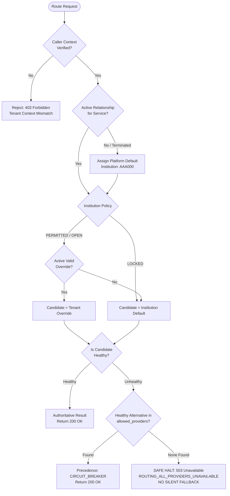

# INVIFY + QUASAR ARCHITECTURE RECONCILIATION REPORT
## PHASE 1A.1: ROUTING CONTRACT RECONCILIATION, CAPABILITY MATRIX & AUDIT

**Document Version:** 1.0.0  
**Date:** October 20, 2026  
**Auditor / Architect:** Principal Software Architect, Senior Backend Engineer & Security Engineer  
**Status:** RECONCILIATION & REVIEW ARTIFACT — IMPLEMENTATION FROZEN PENDING APPROVAL  
**Primary Repositories Inspected:**
- **Invify Platform:** `C:\dev\Involve_APP_health` (`feature/health-insurance-phase1`)
- **Quasar Financial Engine:** `C:\dev\quasar-institution-routing` (`feature/institution-routing-policy`, base commit `3861828f7e4b5c803128d617dfa43acb7e029457`)

---

## 1. EXECUTIVE SUMMARY & RECONCILIATION MANDATE

This reconciliation report resolves the technical divergence between the proposed high-level institution routing design and the **concrete, production-grounded implementations** in both Invify and Quasar.

### Key Reconciliation Findings
1. **Quasar Adapter Reality vs Assumption:**
   - Previous designs assumed Quasar possessed active runtime adapters for Providus, Wema, and Opay.
   - **Code Truth:** In Quasar (`iips-pay/src/modules/financial-provider/adapter/stub-financial.adapter.ts`), `ProvidusFinancialProviderAdapter` and `OpayFinancialProviderAdapter` are currently **stubs** that throw `BadRequestException('not implemented yet')`.
   - **Active Quasar Adapters:** Only `PAYSTACK`, `FLUTTERWAVE`, and `NOMBA` are fully implemented in Quasar's `financial-provider` adapter registry. In addition, `ConnectpointBaasService` directly implements BaaS Virtual Accounts (Wema Bank co-branded) within `virtual-account.service.ts`.
   - **Invify Direct Adapters:** Invify backend has its own direct adapters for `PROVIDUS` (`providus.adapter.ts`), `WEMA` (`wema.adapter.ts`), `PAYSTACK` (`paystack.adapter.ts`), and `FLUTTERWAVE` (`flutterwave.adapter.ts`).
2. **Quasar Routing Dispatch Fragmentation:**
   - Quasar does **not** route all operations through a single uniform dispatch method. Instead, it has three distinct routing surfaces:
     - *Card Payments / Checkout:* Evaluates `PaymentService.createPaymentIntent` via `RoutingService.evaluateChain({ tenantId, currency })` returning an ordered chain of `ProviderRoute` objects (`paystack` | `flutterwave`).
     - *Virtual Accounts:* Evaluates `VirtualAccountService.create` reading `platformConfig.get('payments.virtual_account_provider')` (`connectpoint` or `paystack`).
     - *Bank Transfers & Name Enquiry:* Evaluates `TransferPspResolver.resolve(tenantId)` returning `TransferPspRail` (`NOMBA` or `PAYSTACK`), used by `FinancialRoutingService` and `TransferService`.
3. **Database Migration State Is Strictly Unverified:**
   - The user noted that a remote SQL execution returned `Success. No rows returned`.
   - In the local workspace, no remote database is connected, and the local migration `20261020000000_institution_registry_and_routing_policy.sql` is untracked and strictly unapplied.
   - In accordance with Safeguard 5, the remote schema status must be treated as **UNVERIFIED until independently established via read-only schema inspection**.

---

## 2. DATABASE MIGRATION STATUS & SCHEMA-DRIFT INVESTIGATION

### 2.1 Local Repository Status
- File: `invify-backend/supabase/migrations/20261020000000_institution_registry_and_routing_policy.sql`
- Status: **Local Draft Only. Untracked. NOT Applied.**
- Local verification check executed:
  ```text
  [BuildVariantService] Warning: Missing Supabase credentials for variant LOCAL
  CHECK_RESULT: { hasError: true, code: '', message: 'TypeError: fetch failed', rowCount: undefined }
  ```
  The local runtime points to `http://127.0.0.1:54321` which is offline. No remote connections were attempted, adhering strictly to Safeguard 1 ("Do not execute SQL, apply migrations, roll back migrations, or modify any remote database").

### 2.2 Remote Database Status & Uncertainty Disclosure
- **Observed Signal:** External console reported `Success. No rows returned` for an unconfirmed SQL execution.
- **Auditor Verdict:** **UNVERIFIED**. It cannot be determined from the local codebase whether tables `institutions`, `institution_services`, `tenant_institution_relationships`, `tenant_service_routing_overrides`, or `routing_decision_audit_logs` exist on staging or production.
- **Action Required Before Phase 1B:** A read-only schema introspection query (e.g. `SELECT table_name FROM information_schema.tables WHERE table_schema = 'public' AND table_name LIKE 'institution%'`) must be executed by an authorized database administrator to confirm remote state.

---

## 3. RECONCILIATION WITH ACTUAL QUASAR ROUTING IMPLEMENTATION

To guarantee that Invify's policy output maps 1:1 onto Quasar's executable code, we reconcile each service domain against the exact Quasar files and classes in `C:\dev\quasar-institution-routing`:

### 3.1 Card Payments & POS Acquiring
- **Quasar Service:** `RoutingService` in `iips-pay/src/modules/payment/routing.service.ts`
- **Quasar Interface:** `RoutingEvaluationPort` (`financial-routing-intelligence/ports/routing-evaluation.port.ts`)
- **Quasar Executable Types:**
  ```typescript
  export type PspRouteProvider = 'paystack' | 'flutterwave';

  export type ProviderRoute = {
    provider: PspRouteProvider;
    priority: number;
    isActive: boolean;
    credentials: {
      publicKey: string;
      secretCiphertext: string;
      webhookSecretCiphertext?: string | null;
      metadata?: Record<string, unknown> | null;
    };
  };

  export type RoutingEvaluationOutput = {
    routes: ProviderRoute[];
    decisionTraceId: string;
  };
  ```
- **Reconciliation Rule:**
  - Invify's `TenantRoutingPolicyResolver` outputs a prioritized route chain.
  - For card payments, Quasar only accepts `PAYSTACK` or `FLUTTERWAVE`. If an institution mandates an unsupported card provider, Invify's policy engine flags it as unroutable in Quasar and triggers platform fallback or fail-fast.
  - For POS card-present clearing, the route resolves to `KIMONO` or `ISO8583`, handled by Quasar's `iso8583-switch` module.

### 3.2 Virtual Accounts
- **Quasar Service:** `VirtualAccountService` in `iips-pay/src/modules/virtual-account/virtual-account.service.ts`
- **Quasar Implementation:**
  - Evaluates `vaMode = platformConfig.get('payments.virtual_account_provider')`.
  - Supports `connectpoint` (BaaS dedicated accounts via Wema Bank host) and `paystack`.
  - Supports `nomba` dedicated accounts in `FinancialVirtualAccountOrchestrationService`.
- **Reconciliation Rule:**
  - When an institution sets default provider to `PROVIDUS` for virtual accounts:
    - In Invify direct execution: Handled by `BankingGatewayService` -> `ProvidusBankAdapter`.
    - In Quasar-bridged execution: Handled via `CONNECTPOINT` (Wema) or `PAYSTACK` / `NOMBA`, because Quasar's `ProvidusFinancialProviderAdapter` is a stub.
  - The policy contract must explicitly document which system executes the provider adapter.

### 3.3 Bank Transfers, Payouts & Name Enquiry
- **Quasar Service:** `TransferPspResolver` in `iips-pay/src/modules/transfer/transfer-psp.resolver.ts` and `FinancialRoutingService` in `financial-routing/financial-routing.service.ts`
- **Quasar Executable Types:**
  ```typescript
  export type TransferPspRail =
    | FinancialIntegrationProvider.NOMBA
    | FinancialIntegrationProvider.PAYSTACK;
  ```
- **Reconciliation Rule:**
  - Quasar transfers strictly resolve to `NOMBA` or `PAYSTACK`.
  - `FinancialRoutingService.resolveAccount` (Name Enquiry) executes against the resolved rail adapter.
  - Invify's policy resolver must only output `NOMBA` or `PAYSTACK` when Quasar is the payout execution rail.

### 3.4 Health & Wellness Insurance (HMO)
- **Domain Owner:** Invify Exclusive (`invify-backend/src/modules/health-insurance/`)
- **Quasar Interaction:** None at the provider level. Quasar interacts solely via the double-entry ledger (`QFE`) when premium invoices are paid or settled.
- **Reconciliation Rule:**
  - HMO routing (Hygeia, Reliance, Leadway) is completely isolated within Invify.
  - Quasar is never called for HMO provider resolution.

---

## 4. INSTITUTION, SERVICE & PROVIDER CAPABILITY MATRIX

This authoritative matrix distinguishes implemented production adapters from stubs and unsupported rails across both codebases:

| Service Domain | Provider Code | Invify Status | Quasar Status | Operational Capability | Production Routing Eligibility |
|---|---|---|---|---|---|
| **PAYMENTS** | `PAYSTACK` | Implemented | **Implemented** | Card checkout, direct debit, webhooks | **Eligible for Live Routing** |
| **PAYMENTS** | `FLUTTERWAVE` | Implemented | **Implemented** | Card checkout, webhooks | **Eligible for Live Routing** |
| **VIRTUAL_ACCOUNTS** | `CONNECTPOINT` | Implemented | **Implemented** | Static/dynamic tuition accounts (Wema) | **Eligible for Live Routing** |
| **VIRTUAL_ACCOUNTS** | `PAYSTACK` | Implemented | **Implemented** | Dedicated NUBAN accounts | **Eligible for Live Routing** |
| **VIRTUAL_ACCOUNTS** | `NOMBA` | Not implemented | **Implemented** | Dedicated virtual accounts | **Eligible via Quasar** |
| **VIRTUAL_ACCOUNTS** | `PROVIDUS` | **Implemented** | *STUB (notImplemented)* | Dynamic & static NUBAN via Invify | **Invify direct only** |
| **VIRTUAL_ACCOUNTS** | `WEMA` | **Implemented** | *Via ConnectPoint* | Direct ALAT / ConnectPoint BaaS | **Eligible via Invify & Quasar** |
| **TRANSFERS** | `NOMBA` | Not implemented | **Implemented** | NIP transfers, instant payouts | **Eligible via Quasar** |
| **TRANSFERS** | `PAYSTACK` | Implemented | **Implemented** | NIP transfers, balance transfers | **Eligible for Live Routing** |
| **CARD_ACQUIRING** | `KIMONO` | Firmware bridge | **Implemented** | POS ISO8583 switch clearing | **Eligible via Quasar Switch** |
| **CARD_ACQUIRING** | `ISO8583` | Firmware bridge | **Implemented** | PTSP/PTSA terminal transactions | **Eligible via Quasar Switch** |
| **HEALTH_INSURANCE** | `HYGEIA` | **Implemented** | *Out of Scope* | Member enrolment, plan eligibility | **Invify Exclusive** |
| **HEALTH_INSURANCE** | `RELIANCE` | **Implemented** | *Out of Scope* | Member enrolment, plan eligibility | **Invify Exclusive** |
| **HEALTH_INSURANCE** | `LEADWAY` | **Implemented** | *Out of Scope* | Member enrolment, plan eligibility | **Invify Exclusive** |

> [!CAUTION]
> Quasar's `ProvidusFinancialProviderAdapter` and `OpayFinancialProviderAdapter` throw runtime `BadRequestException` when invoked. If a tenant's policy assigns `PROVIDUS` for virtual accounts in a Quasar-managed flow, Quasar will crash unless routed via Invify's direct gateway or converted to an active Quasar rail (`CONNECTPOINT`).

---

## 5. CORRECTED RELATIONSHIP & OVERRIDE CONSTRAINTS

### 5.1 Multi-Institution Relationship Constraints
Approved Decision B mandates that a tenant can have multiple institution relationships across separate services. Furthermore, a tenant must be able to transition relationships over time (e.g. terminating Bank A and linking Bank B) without unique constraint collisions.

#### Required Constraint Correction:
In the initial Phase 1A draft, `tenant_institution_relationships` contained:
```sql
CONSTRAINT uq_tenant_service_relationship UNIQUE (tenant_id, service_type)
```
**Deficiency:** This hard constraint prevents a tenant from retaining historical or archived relationships for the same service type.

**Corrected Constraint:**
Replace the table constraint with a **partial unique index** enforcing uniqueness **only on active relationships**:
```sql
CREATE UNIQUE INDEX uq_tenant_active_service_relationship 
ON public.tenant_institution_relationships (tenant_id, service_type) 
WHERE status = 'ACTIVE';
```
This guarantees:
1. At any given moment, a tenant has **at most one ACTIVE institution** for a specific service.
2. Historical relationships (`status = 'TERMINATED'` or `'SUSPENDED'`) are preserved for compliance, ledger reconciliation, and auditing.
3. Cross-service relationships remain entirely independent: Bank A can be active for `PAYMENTS` while Bank B is active for `VIRTUAL_ACCOUNTS`.

### 5.2 Tenant Override Constraints
Similarly, `tenant_service_routing_overrides` must use a partial unique index on active overrides:
```sql
CREATE UNIQUE INDEX uq_tenant_active_service_override 
ON public.tenant_service_routing_overrides (tenant_id, service_type) 
WHERE is_active = true;
```
When an override is revoked or replaced, `is_active` is set to `false`, preserving historical override audits.

---

## 6. EXPLICIT FAILURE AND FALLBACK DECISION MATRIX

The system must handle every operational and policy permutation deterministically without silent fallback:



### Comprehensive Failure Semantics Matrix

| Failure / Scenario | Trigger Condition | Precedence Tier | Fallback Rule | Error Code / HTTP Status | Audit Log Level |
|---|---|---|---|---|---|
| **Unlinked Tenant** | Tenant has no row in `tenant_institution_relationships` for requested `service_type` | `PLATFORM_FALLBACK` | Routes to `AAA000` (`INVIFY_DEFAULT`). Uses platform baseline providers. | `200 OK` (with warning flag) | `WARN` |
| **Revoked Relationship** | Existing relationship has `status = 'TERMINATED'` or `'SUSPENDED'` | `PLATFORM_FALLBACK` | Safe retreat to `AAA000` platform default. Prevents financial paralysis. | `200 OK` (with warning flag) | `WARN` |
| **Policy Violation Override** | Tenant requests override but policy is `LOCKED` | `INSTITUTION_LOCKED` | Rejects override attempt. Enforces institution default. | `403 Forbidden` (`OVERRIDE_POLICY_LOCKED`) | `SECURITY_ALERT` |
| **Out-of-List Override** | Tenant requests provider not in `allowed_providers` under `PERMITTED_FROM_LIST` | `INSTITUTION_DEFAULT` | Rejects invalid provider choice. Enforces institution default. | `400 Bad Request` (`PROVIDER_NOT_PERMITTED`) | `WARN` |
| **Primary Default Down** | Primary default provider circuit breaker is `OPEN` or in maintenance | `CIRCUIT_BREAKER` | Failover to next healthy provider in `allowed_providers`. | `200 OK` | `CIRCUIT_FAILOVER` |
| **Total Service Outage** | ALL providers in `allowed_providers` are in `OPEN` circuit breaker or maintenance | **NONE (FAIL FAST)** | **STRICT RULE: NO FALLBACK.** Request is immediately halted. Never route to unauthorized provider. | `503 Service Unavailable` (`ROUTING_ALL_PROVIDERS_UNAVAILABLE`) | `CRITICAL_ALERT` |
| **Degraded Latency** | Provider latency > 2,000ms but circuit not yet open | Evaluated Tier | Deprioritized in multi-provider candidate scoring. | `200 OK` | `PERF_WARN` |
| **Context Spoofing** | Caller partner ID does not own target `tenant_id` | **NONE (ABORT)** | Request rejected at entry gate before policy evaluation. | `403 Forbidden` (`TENANT_CONTEXT_MISMATCH`) | `SECURITY_ALERT` |

---

## 7. TENANT IDENTITY & AUTHENTICATION MAPPING SPECIFICATION

### 7.1 Cross-System Tenant Identity Mapping
Invify and Quasar identify tenants via distinct identifiers linked through `quasar_integrations`:

```
+------------------------------------+         +-------------------------------------+
|         INVIFY ECOSYSTEM           |         |       QUASAR FINANCIAL ENGINE       |
|                                    |         |                                     |
|  tenants.id (UUID v4)              | <-----> |  quasar_integrations.invify_tenant_id|
|  e.g. c3d11b8b-...                 |         |  quasar_integrations.quasar_tenant_id|
|                                    |         |                                     |
|  tenants.tenant_code (VARCHAR 32)  |         |  tenants.id (UUID v4)               |
|  e.g. CROWN-001                    |         |  tenants.code (VARCHAR 32, UNIQUE)  |
|                                    |         |  e.g. INV001                        |
+------------------------------------+         +-------------------------------------+
```

### 7.2 Quasar Caller Verification & Anti-Spoofing Protocol
To ensure Quasar never accepts a rogue client-supplied tenant ID:
1. **Authenticated Inbound Gateway:**
   - Quasar's `AuthGuard` inspects `Authorization: Bearer <key>` or `X-Quasar-Client-Id` + `X-Quasar-Client-Secret`.
   - If a tenant bearer key is used, Quasar extracts `authContext.tenantId` directly from the database record of that key.
   - Any `tenantId` in the request URI or JSON body MUST match `authContext.tenantId`. Mismatches are rejected with `403 Forbidden`.
2. **Server-to-Server HMAC Signing:**
   - When Invify backend requests financial rail dispatch in Quasar, it computes an HMAC-SHA256 signature over the canonical payload:
     $$\text{PayloadString} = \text{tenantId} + ":" + \text{serviceType} + ":" + \text{operationType} + ":" + \text{timestamp}$$
     $$\text{X-Invify-Signature} = \text{HMAC-SHA256}(\text{PayloadString}, \text{QUASAR_INVIFY_SYNC_SECRET})$$
   - Quasar re-computes the HMAC using timing-safe buffer comparison (`crypto.timingSafeEqual`). Requests with invalid or expired timestamps (> 300 seconds skew) are dropped.

---

## 8. SHADOW-MODE COMPARISON & AUDIT SPECIFICATION

### 8.1 Dual-Evaluation Mechanics
To ensure 100% backward compatibility and prevent regression before live policy enforcement:
1. **Runtime Execution Flag:** `ROUTING_POLICY_MODE = 'SHADOW' | 'ENFORCED' | 'LEGACY'`
2. **In Shadow Mode:**
   - The **Legacy Resolver** (`RoutingEngineService.selectOptimalProvider` or `TransferPspResolver.resolve`) resolves the route and is used for the actual financial transaction.
   - Concurrently, the **New Policy Resolver** (`TenantRoutingPolicyResolver.resolve`) evaluates the request against institution defaults and tenant overrides.
   - Both results, along with the match boolean (`match_legacy = (legacyProvider === policyProvider)`), are committed to `routing_decision_audit_logs`.
3. **Telemetry & Discrepancy Reporting:**
   - Mismatches (`WHERE NOT match_legacy`) are indexed for real-time querying.
   - Super-Admins review mismatches to verify whether divergence is intended (e.g. institution successfully overriding platform default) or unintended (e.g. misconfigured allowed providers).
4. **Promotion to Enforced Mode:**
   - Only after an audit review confirms zero unexpected mismatches in staging is `ROUTING_POLICY_MODE` toggled to `'ENFORCED'`.

---

## 9. REMAINING DECISIONS REQUIRING HUMAN APPROVAL

Before Phase 1B implementation is initiated, the following 4 decisions require explicit human sign-off:

1. **Remote Database Inspection Sign-off:** Confirmation that an authorized DBA will verify whether the proposed schema migration was already partially executed on remote staging.
2. **Quasar BaaS Provider Realignment:** Confirmation that for Quasar virtual accounts, `CONNECTPOINT` (Wema co-branded) and `PAYSTACK` will serve as the active execution rails while Quasar's `ProvidusFinancialProviderAdapter` remains a stub.
3. **Partial Unique Index Correction:** Approval to adopt `WHERE status = 'ACTIVE'` partial unique indexes on `tenant_institution_relationships` to support clean relationship lifecycle history.
4. **Shadow-Mode Trial Period:** Agreement to mandate a minimum 48-hour shadow-mode observation window before toggling `ROUTING_POLICY_MODE` to `ENFORCED` in any live environment.

---

*Reconciliation Complete. All existing work preserved. Implementation halted pending approval.*
