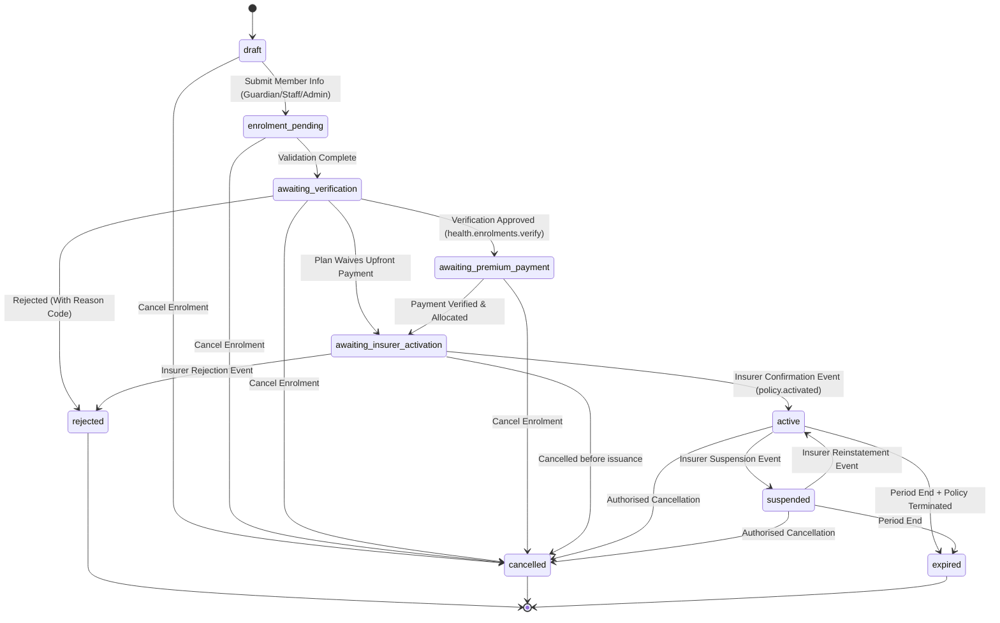
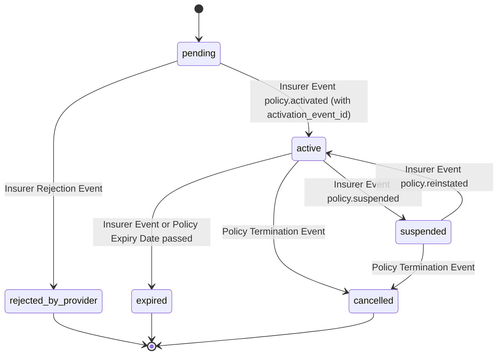
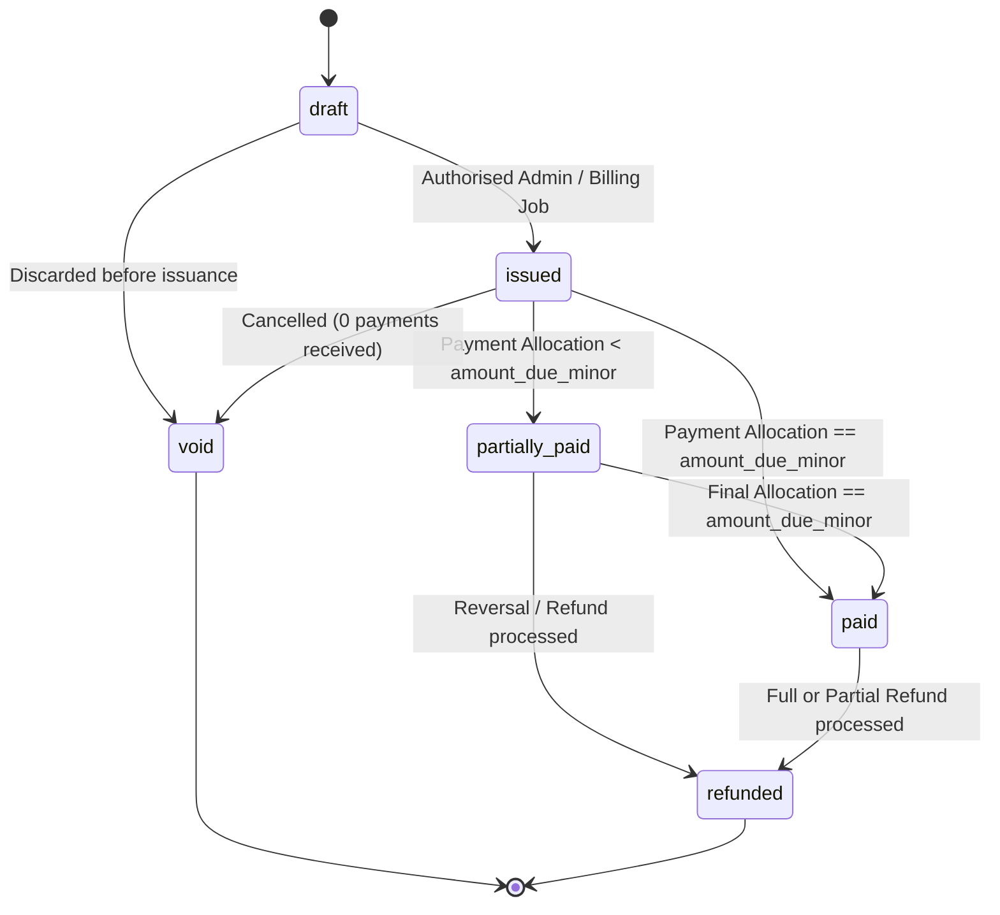
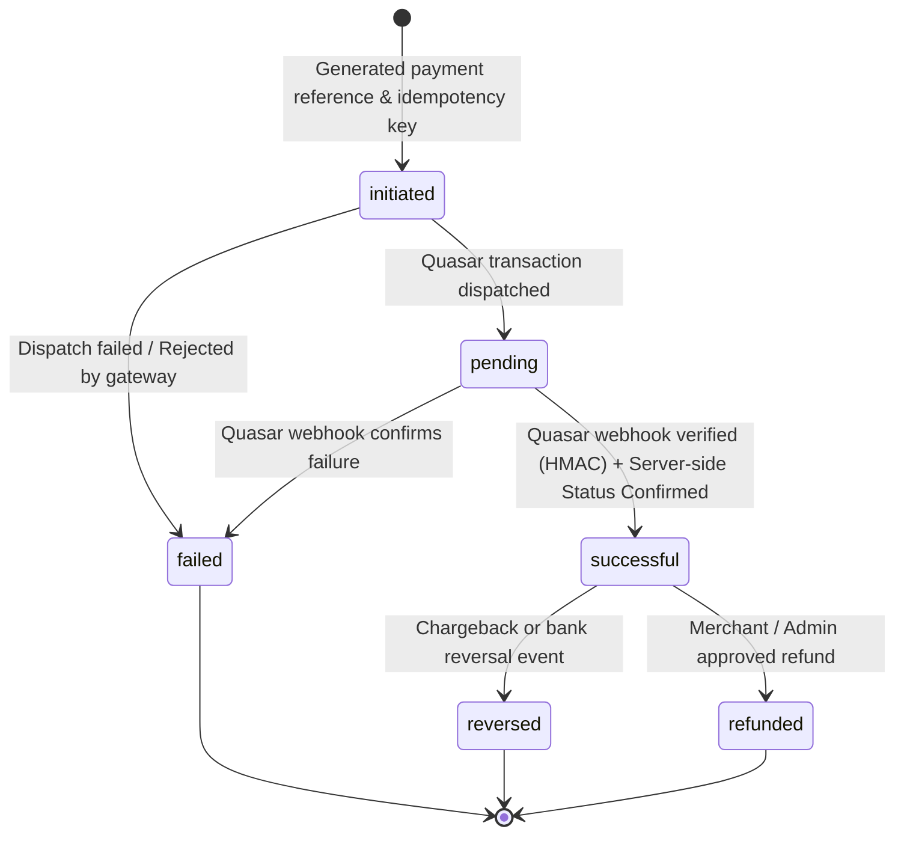

# Invify Health & Wellness — Lifecycle State Machines

**Document:** `docs/health-insurance/05_STATE_MACHINES.md`  
**Phase:** 1 (Design & Architecture)  

---

## 1. Enrolment State Machine (`hw_enrolments.status`)

### Transition Authority Table

| Transition | Permitted Initiator / Event | Validation Required |
|---|---|---|
| `draft` -> `enrolment_pending` | Guardian (`can_manage_enrolment`), Staff Self, or `health.enrolments.manage` | Mandatory identity and contact fields populated |
| `enrolment_pending` -> `awaiting_verification` | System Validation Runner | All plan eligibility prerequisites met |
| `awaiting_verification` -> `awaiting_premium_payment` | User with `health.enrolments.verify` | Document review passed; verifier recorded |
| `awaiting_premium_payment` -> `awaiting_insurer_activation` | System Payment Event Handler | Invoice status is `paid` via confirmed Quasar payment |
| `awaiting_insurer_activation` -> `active` | Verified Provider Webhook (`policy.activated`) | Matching `hw_policies` record exists with status `active` |
| `active` -> `suspended` | Verified Provider Webhook (`policy.suspended`) | Reason logged; insurer event id linked |
| `suspended` -> `active` | Verified Provider Webhook (`policy.reinstated`) | Reinstatement recorded |
| `active` -> `expired` | Scheduled Job + Insurer Expiry Status | `period_end` has passed |

---

## 2. Policy State Machine (`hw_policies.status`)

**Cardinal Rule:** Coverage is NEVER inferred from payment receipt. A policy enters `active` ONLY when a verified cryptographic event or confirmed lookup from the insurance partner arrives.

---

## 3. Premium Invoice State Machine (`hw_premium_invoices.status`)

---

## 4. Payment State Machine (`hw_payments.status`)

**Reconciliation Note:** Reconciliation against the platform internal ledger does not change the payment's functional status. Instead, a dedicated `reconciled_at` timestamp and `ledger_journal_id` are populated. If ledger posting experiences a delay, the payment remains `successful` and coverage activation is not interrupted.
