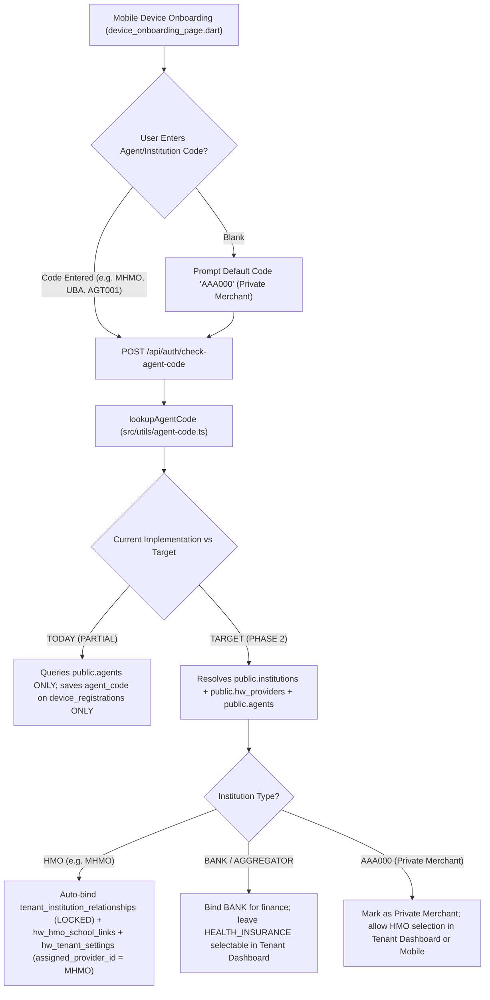
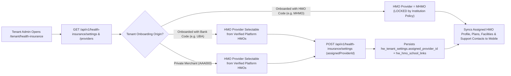
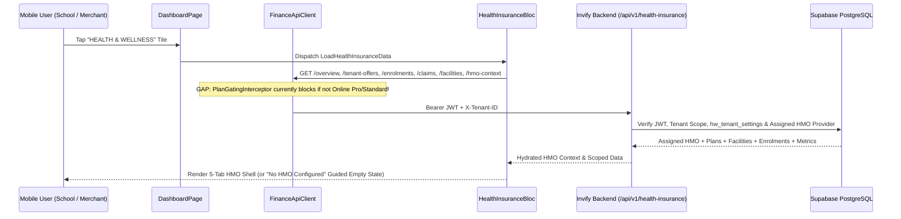
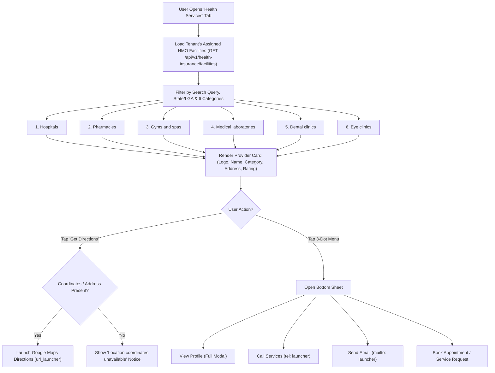
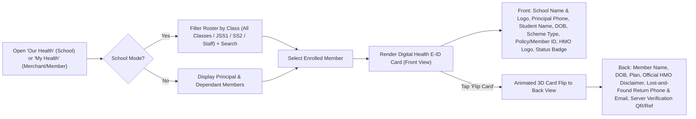
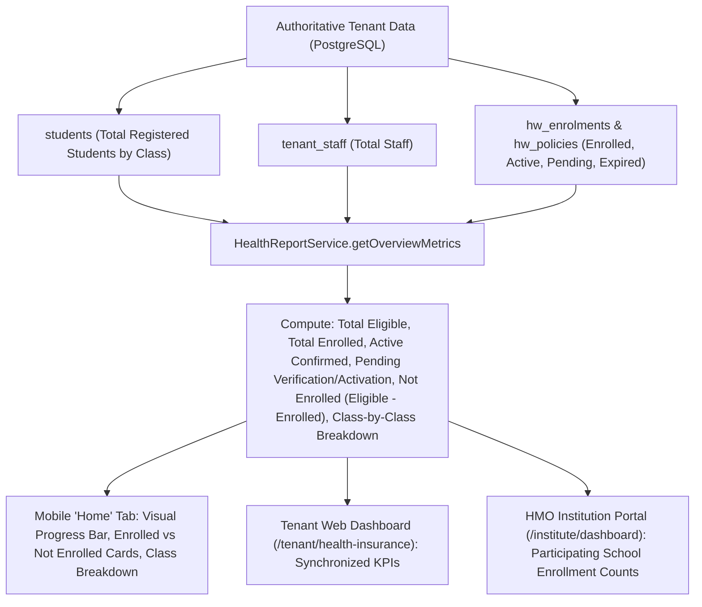

# INVIFY HEALTH INSURANCE — TENANT MOBILE HMO EXPERIENCE
## Phase 1: Read-Only Implementation Audit, User Journey & Gap Analysis

**Document ID:** `23_TENANT_MOBILE_HMO_EXPERIENCE_AUDIT_AND_GAP_ANALYSIS.md`  
**Date:** 2026-10-23  
**Repository:** `C:\dev\Involve_APP_health`  
**Branch:** `feature/health-insurance-phase1`  
**HEAD Commit:** `f9985cedeb4230d194bfb7c7fed97f6f9955c7b7`  
**Audit Mode:** Strictly Read-Only (Zero code, schema, flag, or deployment mutations)

---

## A. Executive Summary

### 1. Current Status of the Tenant Mobile HMO Experience
The Invify Health Insurance platform currently possesses:
- **A complete, staging-verified HMO Institution Portal** (`/institute/dashboard` -> `HmoInstitutionPortalView.vue` + `/api/agent/hmo/*`) and **Super Admin Governance Console** (`/admin/health-insurance` -> `HealthInsuranceGovernancePage.vue` + `/api/v1/health-insurance/platform/*`), backed by PostgreSQL migrations `20261015010000_hw_00_foundation.sql` through `20261022000000_hw_60_hmo_institution_portal.sql`.
- **A foundational Phase 1 Flutter Health & Wellness module** (`lib/features/health_insurance/`) consisting of 4 screens (`HealthWellnessHomePage`, `EnrolmentFlowPage`, `PolicyDetailsPage`, `ClaimsStatusPage`), `HealthInsuranceBloc`, and `HealthInsuranceRepositoryImpl`.

However, **the end-to-end Tenant Mobile HMO Experience does NOT work today as specified in the target product journey.** While a school administrator on a Pro/Standard plan can view basic KPI counts, submit a draft student enrolment, and view a single-sided policy summary card, the target 5-tab mobile HMO experience, automatic institution-code HMO binding during onboarding, tenant web HMO selection, searchable 6-category provider directory with Google Maps directions, two-sided flippable E-ID card, member service-request/appointment workflow, and HMO-configured WhatsApp/Call/Email support are either **missing** or **partially implemented**.

### 2. Does the End-to-End Journey Work Today?
**No (`PARTIAL` / `BLOCKED` across key transitions):**
1. **Onboarding Code -> Automatic HMO Assignment (`MISSING`):** Entering an HMO institution code (e.g., `MHMO`) during Flutter device onboarding (`device_onboarding_page.dart` -> `POST /api/auth/check-agent-code` -> `POST /api/admin/register-device`) only validates against `public.agents`, stores `agent_code` on `device_registrations`, and **never** creates a `tenant_institution_relationships` (`service_type = 'HEALTH_INSURANCE'`), `hw_hmo_school_links`, or `hw_tenant_settings` record.
2. **Bank / Private Merchant HMO Selection in Tenant Web Dashboard (`MISSING`):** Tenants onboarded under a Bank (`institution_type = 'BANK'`) or as a Private Merchant (`AAA000`) have **no UI or backend endpoint** in `/tenant/health-insurance` (`HealthInsuranceDashboardPage.vue`) to select or change their preferred HMO from approved platform HMOs (`hw_providers`), nor does `hw_tenant_settings` store an `assigned_provider_id` / `hmo_lock_mode`.
3. **Mobile Plan-Gating Block (`BLOCKED`):** `PlanGatingInterceptor` in `lib/core/services/finance_api_client.dart` (lines 115–155) does not whitelist `/api/v1/health-insurance/*`. Any device without online Pro/Standard sync enabled receives a client-side `403` before reaching the backend.
4. **Mobile Navigation & Role Security (`PARTIAL` / `SECURITY RISK`):**
   - The `HEALTH & WELLNESS` tile on `DashboardPage` is restricted to `modes: ['school']` (`dashboard_menu_catalog.dart` line 48); private merchants in `retail` or `services` mode cannot access it.
   - `HealthWellnessHomePage` lacks the required 5-tab navigation (`Home`, `Health Services`, `Our Health / My Health`, `Contact`, `Profile`) and instead exposes a client-side `ChoiceChip` bar (lines 93–124) allowing **any** user to freely toggle between `Parent / Guardian`, `Student View`, `School Staff`, and `School Admin`.
5. **Searchable 6-Category Provider Directory (`MISSING` on Mobile, `PARTIAL` on Backend):** Flutter does not call `GET /api/v1/health-insurance/facilities` at all. There is no `HealthServicesPage`, no 6-category filter (`Hospitals`, `Pharmacies`, `Gyms and spas`, `Medical laboratories`, `Dental clinics`, `Eye clinics`), no 3-dot action sheet (`View Profile`, `Call Services`, `Send Email`, `Book Appointment`), and `hw_facilities` lacks `latitude`, `longitude`, `email`, `logo_url`, `rating`, and the `gym_spa` category constraint.
6. **Two-Sided Digital Health E-ID Card (`PARTIAL`):** `HealthWellnessHomePage` and `PolicyDetailsPage` render a static, single-sided container. There is no front/back card flip, no school logo/name, no Principal's contact, no Date of Birth (`dob`), no Scheme Type, no HMO logo, no Back-of-Card disclaimer/lost-and-found instructions, and no cryptographic verification token/QR check.
7. **Service Requests / Appointments (`Our Requests`) (`MISSING`):** Mobile only displays read-only `ClaimsStatusPage` (`GET /api/v1/health-insurance/claims`). Members and school admins cannot submit or track service requests, pre-authorization requests, or hospital appointment bookings from mobile.

### 3. Major Security & Data-Integrity Risks Identified
- **SR-01 (High — Client-Side Role Switching on Mobile):** `HealthWellnessHomePage` (lines 93–124) renders an unrestricted `ChoiceChip` selector (`SwitchHealthUserRole`) that lets any mobile operator switch into `School Admin`, `Parent / Guardian`, `Student`, or `Staff` views without server-side role/session re-validation.
- **SR-02 (High — Unscoped Tenant Web Policy Activation UI):** `HealthInsuranceDashboardPage.vue` (lines 205–212, 884–908) displays an `"Activate Policy"` button to the Tenant Admin that fabricates a random `POL-xxxxxx` number on the client and calls `POST /api/v1/health-insurance/enrolments/:id/activate-policy` (aliased to `simulateSandboxActivation` in `register-routes.ts` line 161). In staging/dev, this lets a school admin self-activate insurance coverage without HMO confirmation!
- **SR-03 (Medium — In-Memory BLoC State Retained Across Logout / Tenant Switch):** `HealthInsuranceBloc` is provided as a root singleton in `lib/main.dart` (lines 869–873) and is never reset on logout or tenant switch, risking cross-session display of cached `metrics`, `enrolments`, `guardianChildren`, and `claims`.
- **SR-04 (Medium — Cross-HMO Facility Leakage on Tenant Endpoint):** `GET /api/v1/health-insurance/facilities` (`HealthPlanService.listFacilities` in `health-plan.service.ts` lines 145–159) returns active rows from `hw_facilities` without filtering by the tenant's assigned HMO (`provider_id`), exposing facilities from other HMOs unless the client manually passes `?providerId=...`.
- **SR-05 (Medium — Non-Expiring Device JWT on Mobile Onboarding):** `OnboardingController.register` (`onboarding.controller.ts` lines 1069–1079) signs an offline HS256 JWT with `{ sub, id, email, role: 'owner', tenantId, deviceId }` and no `expiresIn` claim, which `resolveAuthToken` in `lib/main.dart` (lines 200–238) permanently prioritizes over Supabase session tokens.

---

## B. Implementation Matrix

| # | Area / Feature | Status | Frontend / Mobile Files & Symbols | Backend Routes & Services | Database Tables & Columns | Automated Tests |
| :- | :--- | :--- | :--- | :--- | :--- | :--- |
| **1.1** | **Institution Code Resolution (`HMO` vs `BANK` vs `AAA000`)** | `PARTIAL` | `lib/features/activation/presentation/pages/device_onboarding_page.dart` (`_validateAgentCode`, `_askUseInvifyDefaultAgent`) | `POST /api/auth/check-agent-code` -> `lookupAgentCode` (`src/utils/agent-code.ts`); `InstitutionClassificationService.resolveForAgentOrUser` (`src/modules/health-insurance/services/institution-classification.service.ts`) | `public.agents`, `public.institutions`, `public.hw_providers` | `invify-backend/test/institution-routing-contract.test.ts`, `invify-backend/test/hmo-institution-portal.test.ts` |
| **1.2** | **Onboarding HMO Auto-Binding (`MHMO` -> Tenant Link)** | `MISSING` | `lib/features/activation/presentation/pages/device_onboarding_page.dart` (`_submitRegistration`) | `POST /api/admin/register-device` -> `OnboardingController.register` (`src/controllers/onboarding.controller.ts` L776–1020) only writes `device_registrations.agent_code` | Missing inserts into `tenant_institution_relationships`, `hw_hmo_school_links`, `hw_tenant_settings` | None |
| **2.1** | **Tenant Dashboard HMO Selection (Bank / Private Merchant)** | `MISSING` | `invify-admin/src/domains/tenant/health-insurance/pages/HealthInsuranceDashboardPage.vue` (No HMO selector or lock badge) | `GET/POST /api/v1/health-insurance/settings` (`HealthSettingsService` in `health-settings.service.ts`) lacks `assigned_provider_id` & lock enforcement | `public.hw_tenant_settings` lacks `assigned_provider_id`, `assignment_source` (`institution_locked`, `tenant_selected`) | None |
| **2.2** | **Tenant Web Dashboard API Alignment** | `PARTIAL` | `invify-admin/src/domains/tenant/health-insurance/pages/HealthInsuranceDashboardPage.vue`, `invify-admin/src/api/healthInsuranceApi.js` | `/api/v1/health-insurance/*` (`HealthController` in `health.controller.ts`) — multiple snake_case vs camelCase payload mismatches & missing `/policies`, `/billing/invoices` GET routes | `hw_enrolments`, `hw_policies`, `hw_guardian_links`, `hw_premium_invoices` | `invify-backend/test/health-insurance.test.ts` |
| **3.1** | **Mobile Dashboard Entry Tile (`HEALTH & WELLNESS`)** | `PARTIAL` | `lib/features/dashboard/domain/catalog/dashboard_menu_catalog.dart` (L48: `modes: ['school']` only); `lib/features/dashboard/presentation/pages/dashboard_page.dart` (L872) | N/A (Client-side mode gate) | Local SQLite `settings.businessMode` | `test/features/health_insurance/health_insurance_staging_uat_test.dart` |
| **3.2** | **Mobile 5-Tab HMO Shell (`Home`, `Health Services`, `Our/My Health`, `Contact`, `Profile`)** | `MISSING` | `lib/features/health_insurance/presentation/pages/health_wellness_home_page.dart` (Currently single page with insecure 4-role `ChoiceChip` switcher at L93–124) | N/A | N/A | None |
| **3.3** | **Mobile PlanGatingInterceptor & Logout Cache Reset** | `BLOCKED` | `lib/core/services/finance_api_client.dart` (`PlanGatingInterceptor` L115–155 blocks `/api/v1/health-insurance/*` on Basic/offline); `lib/main.dart` (L869–873 root singleton `HealthInsuranceBloc` never cleared) | `/api/v1/health-insurance/*` | N/A | None |
| **4.1** | **Home Tab — Enrollment Analytics (Enrolled vs Not Enrolled & Class Breakdown)** | `PARTIAL` | `lib/features/health_insurance/presentation/pages/health_wellness_home_page.dart` (`_buildAdminView` L885–957 shows `enrolledMembers`, `insurerConfirmedActive`, `awaitingVerification`, `incompleteEnrolments`, `coverageRatePercent`, but lacks explicit `notEnrolledCount` card & per-class breakdown) | `GET /api/v1/health-insurance/overview` -> `HealthReportService.getOverviewMetrics` (`health-report.service.ts` L10–93) | `public.students`, `public.hw_members`, `public.hw_enrolments`, `public.hw_premium_invoices` | `test/features/health_insurance/health_insurance_entities_test.dart`, `invify-backend/test/health-insurance.test.ts` |
| **5.1** | **Health Services — Searchable 6-Category Provider Directory** | `MISSING` | Not implemented in `lib/features/health_insurance/` (`HealthInsuranceRepository` does not call `/facilities`) | `GET /api/v1/health-insurance/facilities` -> `HealthPlanService.listFacilities` (`health-plan.service.ts` L145–159) — unscoped by tenant's HMO, missing category/search filters | `public.hw_facilities` (has `facility_type` in `hw_60` with `hospital, clinic, pharmacy, laboratory, dental, optical` — missing `gym_spa`, `email`, `logo_url`, `rating`, `latitude`, `longitude`) | `invify-backend/test/hmo-institution-portal.test.ts` (HMO portal side only) |
| **5.2** | **Health Services — 3-Dot Provider Actions & Google Maps Directions** | `MISSING` | Not implemented (`View Profile`, `Call Services`, `Send Email`, `Book Appointment`, `Get Directions` via `url_launcher`) | Missing appointment/booking endpoint | `public.hw_facilities` lacks `latitude`, `longitude`, `email`, `operating_hours` | None |
| **6.1** | **Our Health — Student & Staff Membership Roster with Class Filtering** | `PARTIAL` | `lib/features/health_insurance/presentation/pages/enrolment_flow_page.dart` (groups local students by class for *new* enrolment); `health_wellness_home_page.dart` (L1037–1070 lists top 15 raw enrolments without class filter, search, DOB, or principal contact) | `GET /api/v1/health-insurance/enrolments` (`HealthEnrolmentService.listEnrolments`), `GET /api/v1/health-insurance/members` (`HealthMemberService.listMembers`) | `public.hw_members`, `public.hw_enrolments`, `public.students` (`date_of_birth` check needed), `public.hw_staff_profiles` | `test/features/health_insurance/health_insurance_widgets_test.dart` |
| **6.2** | **Digital Health E-ID Card (Front + Back Flip + Verification)** | `PARTIAL` | `lib/features/health_insurance/presentation/pages/health_wellness_home_page.dart` (`_buildStudentDigitalIdCard` L569–689) & `policy_details_page.dart` (`_buildDigitalCoverageCard` L76–231) — single-sided only | `GET /api/v1/health-insurance/enrolments` | `hw_policies`, `hw_enrolments`, `hw_members`, `hw_providers` (missing school logo, principal contact, DOB, scheme type, card back terms, lost-and-found contacts, verification endpoint) | `test/features/health_insurance/health_insurance_staging_uat_test.dart` |
| **7.1** | **Our Requests — Service Requests, Pre-Auth & Appointment Approvals** | `BACKEND ONLY` (HMO Side) / `MISSING` (Mobile) | `lib/features/health_insurance/presentation/pages/claims_status_page.dart` only lists read-only claims (`GET /claims`). No mobile request creation or status timeline | HMO Portal has `GET /api/agent/hmo/claims` & `POST /api/agent/hmo/claims/:id/adjudicate` (`HmoPortalService.adjudicateClaimOrPreAuth`), but Tenant/Mobile lacks `POST /api/v1/health-insurance/requests` | `public.hw_claim_status_records` (supports `pre_authorisation` and `claim`, but requires `policy_id` and lacks appointment/service-request metadata) | `invify-backend/test/hmo-institution-portal.test.ts` |
| **8.1** | **Contact — HMO Support (`Call Us` Confirmation, `Send HMO Email`, `Chat With Us` WhatsApp)** | `MISSING` | `health_wellness_home_page.dart` (L694–729 hardcodes static `'Emergency Extension: 112 / 0800-INVIFY-HEALTH'`); `lib/features/dashboard/presentation/pages/contact_page.dart` is a school staff/teacher/parent phonebook | No tenant endpoint returning the assigned HMO's `contact_phone`, `support_email`, `claims_email`, `whatsapp_number` | `public.hw_providers` has `contact_email`, `contact_phone`, `support_email`, `claims_email` (missing `whatsapp_phone`) | None |
| **9.1** | **Profile — HMO & Coverage Configuration Summary** | `MISSING` | Not implemented in `lib/features/health_insurance/` | `GET /api/v1/health-insurance/settings` + `GET /api/v1/health-insurance/tenant-offers` | `public.hw_tenant_settings`, `public.hw_providers`, `public.hw_tenant_plan_offers` | None |

---

## C. User-Journey Diagrams

### 1. Institution Onboarding & Code Resolution


### 2. Tenant Dashboard HMO Assignment


### 3. Mobile HMO Initialization


### 4. Provider Discovery & Contact (`Health Services` Tab)


### 5. Member / E-ID Experience (`Our Health` / `My Health`)


### 6. Service Request & Approval (`Our Requests`)
```mermaid
sequenceDiagram
    participant Member as School Admin / Member (Mobile)
    participant API as Backend (/api/v1/health-insurance)
    participant DB as PostgreSQL (hw_service_requests / hw_claim_status_records)
    participant HMO as HMO Institution Portal (/institute/dashboard)

    Member->>API: POST /api/v1/health-insurance/requests (Member, Facility, Service Type, Preferred Date, Notes)
    API->>DB: Validate Active Policy & Same-HMO Facility; Insert Request (status = 'submitted')
    DB-->>Member: Request Created (Reference Code)
    HMO->>API: GET /api/agent/hmo/claims (or /requests)
    API-->>HMO: List Pending Pre-Auth / Service Requests
    HMO->>API: POST /api/agent/hmo/claims/:id/adjudicate (decision = 'approved' | 'rejected', authCode, reason)
    API->>DB: Update Status, Record Authorisation Code & Audit Trail
    Member->>API: GET /api/v1/health-insurance/requests (Pull-to-Refresh)
    API-->>Member: Updated Status Badge ('Approved' with Auth Code or 'Rejected' with Reason)
```

### 7. Enrollment Analytics (`Home` Tab & Dashboards)


---

## D. Gap Register

| Gap ID | Title & Description | Impact | Security / Data-Integrity Risk | Dependencies | Recommended Wave | Acceptance Criteria |
| :- | :--- | :--- | :--- | :--- | :-: | :--- |
| **GAP-01** | **Onboarding Institution Code Resolution & Automatic HMO Linking:** `lookupAgentCode` (`src/utils/agent-code.ts`) only queries `public.agents`, and `OnboardingController.register` (`src/controllers/onboarding.controller.ts`) only writes `agent_code` to `device_registrations`. Entering `MHMO` does not create a `tenant_institution_relationships` row (`service_type = 'HEALTH_INSURANCE'`), an `hw_hmo_school_links` row, or set the tenant's assigned HMO in `hw_tenant_settings`. | High — Schools onboarding with `MHMO` are not connected to MHMO in the Health Insurance module or HMO Portal. | Medium — Orphaned onboarding relationships; inconsistent tenant routing between finance and health insurance. | `20261020000000_institution_registry_and_routing_policy.sql`, `20261022000000_hw_60_hmo_institution_portal.sql` | **Wave 1** | 1. `POST /api/auth/check-agent-code` resolves `HMO`, `BANK`, `AGGREGATOR`, and `AAA000` and returns `institutionType` + `institutionName`.<br>2. Onboarding with an HMO code (`MHMO`) atomically creates/updates `tenant_institution_relationships` (`LOCKED`), `hw_hmo_school_links`, and `hw_tenant_settings.assigned_provider_id`.<br>3. Onboarding with a Bank code or `AAA000` leaves HMO selection unlocked. |
| **GAP-02** | **Tenant Dashboard HMO Selection & Lock Policy (`hw_tenant_settings`):** `hw_tenant_settings` has no `assigned_provider_id` or `hmo_assignment_mode` column. `HealthInsuranceDashboardPage.vue` has no UI for a Bank-onboarded school or Private Merchant (`AAA000`) to select an HMO from `hw_providers`, nor does it show a locked HMO badge when onboarded via an HMO code. | High — Bank-onboarded schools and private merchants cannot choose an HMO in the tenant web dashboard. | Medium — Tenants could configure plan offers from multiple conflicting HMOs without a primary assigned HMO context. | GAP-01, additive migration on `hw_tenant_settings` | **Wave 1** | 1. Additive migration adds `assigned_provider_id UUID REFERENCES hw_providers(id)` and `assignment_mode TEXT ('LOCKED','SELECTABLE')` to `hw_tenant_settings`.<br>2. `GET /api/v1/health-insurance/settings` returns the assigned HMO provider profile, support contacts, and lock status.<br>3. `POST /api/v1/health-insurance/settings` allows selecting an active verified HMO only when `assignment_mode !== 'LOCKED'`.<br>4. `HealthInsuranceDashboardPage.vue` displays the HMO selector/locked banner and fixes its API payload mismatches. |
| **GAP-03** | **Remove Unverified Tenant Self-Activation & Client-Side Role Switcher (Security Hardening):**<br>1. `HealthWellnessHomePage` (L93–124) lets any mobile user tap `ChoiceChip`s to switch roles.<br>2. `HealthInsuranceDashboardPage.vue` (L205–212) exposes `"Activate Policy"` to tenant admins.<br>3. `PlanGatingInterceptor` (`finance_api_client.dart` L115–155) blocks `/api/v1/health-insurance/*` when offline sync is disabled.<br>4. `HealthInsuranceBloc` retains state across logout. | Critical — Blocks mobile API calls on non-Pro devices and exposes role-bypass / self-activation UX flaws. | **High** — Privilege escalation in mobile UI (`ChoiceChip` role switcher) and misleading tenant policy activation UI. | None | **Wave 1** | 1. Remove unrestricted client-side role switcher `ChoiceChip` from `HealthWellnessHomePage`; derive view mode from authenticated user/tenant business mode.<br>2. Whitelist `/api/v1/health-insurance/` in `PlanGatingInterceptor` so onboarded HMO tenants can access their HMO portal.<br>3. Add `ResetHealthInsuranceState` event to `HealthInsuranceBloc` and dispatch on logout/tenant switch.<br>4. Restrict `/activate-policy` in `HealthInsuranceDashboardPage.vue` to explicit sandbox-only labeling or HMO reconciliation. |
| **GAP-04** | **Mobile 5-Tab Navigation Shell & Private Merchant Mode Support:**<br>1. `dashboard_menu_catalog.dart` (L48) restricts `health_wellness` tile to `modes: ['school']`.<br>2. `HealthWellnessHomePage` is a single scrolling page instead of the 5-tab HMO shell (`Home`, `Health Services`, `Our Health / My Health`, `Contact`, `Profile`). | High — Mobile users cannot navigate to `Health Services`, `Contact`, or `Profile`, and `retail`/`services` tenants cannot see the tile. | Low | GAP-02, GAP-03 | **Wave 2** | 1. Enable `health_wellness` tile in `dashboard_menu_catalog.dart` for `['school', 'retail', 'services']`.<br>2. Refactor `HealthWellnessHomePage` into a 5-tab `BottomNavigationBar` / `TabBar` shell (`Home`, `Health Services`, `Our Health` / `My Health`, `Contact`, `Profile`).<br>3. Show a clean "No HMO Configured" state when `assigned_provider_id` is null. |
| **GAP-05** | **Home Tab — Enrollment Analytics (Enrolled vs Not Enrolled & Class Breakdown):** `HealthReportService.getOverviewMetrics` computes `eligibleMembers` and `enrolledMembers`, but does not return `notEnrolledMembers`, `staffEligibleMembers`, `staffEnrolledMembers`, or a per-class enrollment breakdown (`classBreakdown`). | Medium — School admins cannot see how many students/staff are **not enrolled** or compare enrollment rates by class. | Low — Analytics must come strictly from real DB queries (`students`, `tenant_staff`, `hw_enrolments`). | GAP-04 | **Wave 2** | 1. `GET /api/v1/health-insurance/overview` returns `notEnrolledMembers`, `studentsEligible`, `studentsEnrolled`, `staffEligible`, `staffEnrolled`, and `classBreakdown: [{ className, totalStudents, enrolledStudents, activePolicies }]`.<br>2. Mobile `Home` tab renders Enrolled vs Not Enrolled summary cards, progress bar, and class breakdown list. |
| **GAP-06** | **Health Services — 6-Category Searchable Provider Directory, 3-Dot Actions & Google Maps Directions:**<br>1. `hw_facilities` (`hw_60`) constrains `facility_type` to `('hospital','clinic','pharmacy','laboratory','dental','optical')` (missing `'gym_spa'`) and lacks `email`, `logo_url`, `rating`, `latitude`, `longitude`.<br>2. `GET /api/v1/health-insurance/facilities` does not filter by the tenant's assigned HMO or `facility_type`/`search`.<br>3. Flutter has no `HealthServicesTab` or facility models/repository methods. | High — Core user journey (`Health Services` provider search, category filter, directions, and contact) is completely absent on mobile. | Medium — `GET /facilities` currently leaks facilities across all HMOs if `providerId` is omitted. | Additive migration on `hw_facilities` | **Wave 3** | 1. Additive migration extends `hw_facilities` with `email`, `logo_url`, `rating`, `latitude`, `longitude`, and adds `'gym_spa'` to `facility_type` check constraint; seeds verified coordinates/categories for MHMO staging facilities.<br>2. `GET /api/v1/health-insurance/facilities` scopes by tenant's assigned HMO (`provider_id`) and supports `category`, `search`, `state`, `lga` filters.<br>3. Mobile `Health Services` tab implements search bar, 6 category chips (`Hospitals`, `Pharmacies`, `Gyms and spas`, `Medical laboratories`, `Dental clinics`, `Eye clinics`), `Get Directions` (Google Maps launcher), and 3-dot bottom sheet (`View Profile`, `Call Services`, `Send Email`, `Book Appointment`). |
| **GAP-07** | **Our Health / My Health — Class-Filtered Roster & Two-Sided Flippable Digital E-ID Card:**<br>1. Mobile roster does not support class filtering (`All Classes`, `JSS 1`, etc.) or search.<br>2. Mobile E-ID card is single-sided and missing School Name/Logo, Principal's Contact, DOB, Scheme Type, HMO Logo, Back-of-Card disclaimer, and Lost-and-Found return phone/email. | High — Members and schools cannot present a complete front-and-back HMO E-ID card at hospitals. | Medium — E-ID must never display `"ACTIVE"` unless `hw_policies.status = 'active'` is confirmed in the backend. | GAP-02, GAP-04 | **Wave 4** | 1. `GET /api/v1/health-insurance/enrolments` includes member `date_of_birth` (from `students`/`hw_dependants`), school name/logo/principal phone (from `tenants`), HMO logo/support phone/email (from `hw_providers`), and `scheme_type`.<br>2. Mobile `Our Health` tab filters enrolled members by class and search query.<br>3. Mobile E-ID widget supports interactive Front/Back flip with all required Front fields and Back disclaimer + lost-and-found contacts. |
| **GAP-08** | **Our Requests — Service Request / Pre-Authorization / Appointment Submission & Tracking:** Mobile only has read-only `ClaimsStatusPage`. Neither mobile nor `/api/v1/health-insurance` has an endpoint for a member or school admin to submit a service/appointment request (`POST /api/v1/health-insurance/requests`) that flows into the HMO Institution Portal for approval/rejection. | High — Members cannot book appointments or request HMO pre-authorization from mobile. | Medium — Requests must be tenant-scoped, linked to a valid member & facility of the tenant's HMO, and audited. | GAP-06 | **Wave 5** | 1. Additive table or extension (`public.hw_service_requests` or `hw_claim_status_records` extension) + `GET/POST /api/v1/health-insurance/requests` for tenant/mobile and adjudication hook in `/api/agent/hmo/claims`.<br>2. Mobile `Our Requests` view (accessible from `Home` / `Our Health` / `Book Appointment`) allows creating a service/appointment request and viewing status history (`Pending`, `Approved`, `Rejected`). |
| **GAP-09** | **Contact & Profile Tabs — HMO Support Channels (`Call Us` Confirmation, `Send HMO Email`, `Chat With Us` WhatsApp) & HMO Profile View:** Mobile currently hardcodes a static campus clinic banner and has no HMO Contact or Profile tab. | Medium — Users cannot call, email, or WhatsApp their assigned HMO from the Health & Wellness module. | Low — `url_launcher` must validate phone/email/WhatsApp URIs and show a confirmation dialog before dialing. | GAP-02, GAP-04 | **Wave 5** | 1. Mobile `Contact` tab displays `Call Us` (with confirmation modal before launching `tel:`), `Send HMO Email` (`mailto:`), and `Chat With Us` (`https://wa.me/...`) using the tenant's assigned HMO support details.<br>2. Mobile `Profile` tab displays the tenant's organization details, assigned HMO details, NHIA licence, active plan offers, and coverage summary. |

---

## E. Release Readiness & Prioritized Implementation Plan

### 1. Existing Automated Test Results (Verified Read-Only)
- **Flutter Mobile Health Insurance Suite (`flutter test test/features/health_insurance`):**
  - **Result:** **32 / 32 tests passing** (`health_insurance_bloc_test.dart`, `health_insurance_entities_test.dart`, `health_insurance_repository_test.dart`, `health_insurance_staging_uat_test.dart`, `health_insurance_widgets_test.dart`).
- **Backend Jest Suite (`invify-backend`):**
  - **Result:** **109 / 109 tests passing** across 3 suites (`test/health-insurance.test.ts`, `test/hmo-institution-portal.test.ts`, `test/institution-routing-contract.test.ts`).

### 2. Missing Test Coverage
- Unit/integration tests for HMO code resolution (`MHMO` vs `BANK` vs `AAA000`) during `/api/auth/check-agent-code` and `/api/admin/register-device`.
- Backend tests for tenant HMO selection (`LOCKED` when onboarded via HMO code vs `SELECTABLE` when onboarded via Bank or `AAA000`).
- Backend tests for tenant-scoped facility directory filtering (6 categories, search, coordinates) and service request submission/approval lifecycle.
- Flutter widget and BLoC tests for:
  - 5-tab HMO navigation (`Home`, `Health Services`, `Our Health / My Health`, `Contact`, `Profile`)
  - 6-category provider directory filter, 3-dot bottom sheet, and Google Maps launch
  - Class-filtered member roster and Front/Back E-ID card flip
  - `Call Us` confirmation dialog, `Send HMO Email`, and `Chat With Us` WhatsApp deep link
  - State reset on logout / tenant switch

### 3. Observed Feature-Flag & Database Status
- **Backend Feature Flags:**
  - `FEATURE_HEALTH_INSURANCE_ENABLED`: Checked by `requireHealthInsuranceEnabled` (`health-flag.guard.ts`) and `institutionClassificationService`.
  - `FEATURE_HEALTH_INSURANCE_HMO_PORTAL`: Checked by `institutionClassificationService` (defaults to `true` unless explicitly `'false'`).
- **Database Migrations Applied on Staging (`rpcjelhacmkhzguljdgi`):**
  - `20261015010000_hw_00_foundation.sql` through `20261015060000_hw_50_platform_grants_maker_checker.sql`
  - `20261020000000_institution_registry_and_routing_policy.sql`
  - `20261022000000_hw_60_hmo_institution_portal.sql` (including seeded `MHMO` institution, `HEALTH_INSURANCE` service, `mhmo` provider, and default CSV export mapping).
- **Schema Additions Needed in Phase 2 (Additive Migration Only):**
  1. `public.hw_tenant_settings`: add `assigned_provider_id UUID REFERENCES public.hw_providers(id)`, `assignment_mode TEXT DEFAULT 'SELECTABLE' CHECK (assignment_mode IN ('LOCKED', 'SELECTABLE'))`, `assigned_institution_id UUID REFERENCES public.institutions(id)`.
  2. `public.hw_providers`: add `whatsapp_phone TEXT`.
  3. `public.hw_facilities`: expand `facility_type` check constraint to include `'gym_spa'`, and add `email TEXT`, `logo_url TEXT`, `rating NUMERIC(3,2)`, `latitude DOUBLE PRECISION`, `longitude DOUBLE PRECISION`, `operating_hours TEXT`.
  4. `public.hw_service_requests` (or additive columns on `public.hw_claim_status_records`): support member/school appointment & pre-authorization requests from mobile with HMO adjudication sync.

### 4. Recommended Next Phase — Prioritized Phase 2 Implementation Plan
To deliver the complete Tenant Mobile HMO Experience safely and incrementally without breaking existing Bank, POS, or School Finance workflows:

1. **Wave 1 — Onboarding HMO Auto-Binding, Tenant HMO Selection & Security Hardening (`GAP-01`, `GAP-02`, `GAP-03`):**
   - Create additive migration `20261023000000_hw_70_tenant_mobile_hmo_experience.sql`.
   - Enhance `lookupAgentCode` and `OnboardingController.register` so onboarding with an HMO code (`MHMO`) automatically binds `tenant_institution_relationships` (`LOCKED`), `hw_hmo_school_links`, and `hw_tenant_settings.assigned_provider_id`.
   - Add HMO selection & lock enforcement to `HealthSettingsService` and `HealthInsuranceDashboardPage.vue` for Bank-onboarded and Private Merchant (`AAA000`) tenants.
   - Whitelist `/api/v1/health-insurance/` in `PlanGatingInterceptor`, remove the insecure client-side role switcher `ChoiceChip`, and reset `HealthInsuranceBloc` on logout.
2. **Wave 2 — Mobile 5-Tab HMO Shell & Home Enrollment Analytics (`GAP-04`, `GAP-05`):**
   - Enable `HEALTH & WELLNESS` tile across `school`, `retail`, and `services` modes.
   - Build the 5-tab mobile shell (`Home`, `Health Services`, `Our Health / My Health`, `Contact`, `Profile`) and enhance `HealthReportService.getOverviewMetrics` with `notEnrolledMembers` and per-class enrollment breakdown.
3. **Wave 3 — Searchable 6-Category Provider Directory & Google Maps Directions (`GAP-06`):**
   - Scope `GET /api/v1/health-insurance/facilities` to the tenant's assigned HMO with category/search filters and build the `Health Services` mobile tab with 6 categories (`Hospitals`, `Pharmacies`, `Gyms and spas`, `Medical laboratories`, `Dental clinics`, `Eye clinics`), 3-dot action sheet, and Google Maps directions.
4. **Wave 4 — Class-Filtered Member Roster & Flippable Front/Back Digital E-ID Card (`GAP-07`):**
   - Enrich member/enrolment responses with DOB, school logo/principal phone, HMO logo/contacts, and scheme type; build the class-filtered `Our Health` roster and interactive Front/Back flippable E-ID card.
5. **Wave 5 — Service Requests (`Our Requests`), HMO `Contact` Tab & `Profile` Tab (`GAP-08`, `GAP-09`):**
   - Implement mobile service/appointment request submission & HMO portal adjudication sync, the HMO `Contact` tab (`Call Us` confirmation dialog, `Send HMO Email`, `Chat With Us` WhatsApp), and the `Profile` tab, followed by full Jest and Flutter test verification.
